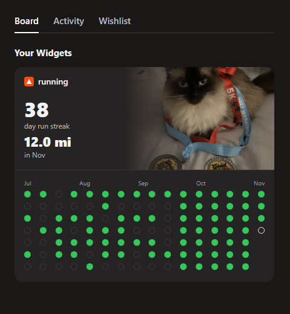

# Strava run-streak widget for my Discord profile

Goal: a Discord profile widget (Board tab, next to the Cannoli widget) that shows my current run streak, this month's mileage and a dot grid of recent run days, updated every day from Strava.



`mockup.html` is the HTML used for the mockup, built from real data on 2026-11-04 (38-day streak, 12.0 mi in Nov, 16 weeks of dots).

## What already exists

All of this is in `C:\CS\jovci` (GitHub `Jovci/Jovci`, the profile README repo):

| Piece | Where | Notes |
|---|---|---|
| Strava fetch + SVG render | `scripts/strava-graph.mjs` | Node 20, no dependencies. Refresh-token auth, pages `/athlete/activities`, counts Run/TrailRun/VirtualRun incl. private, buckets by `start_date_local[0:10]`, computes streak (back from today, or yesterday if no run today) and month total |
| Daily job | `.github/workflows/strava-graph.yml` | 08:00 UTC + manual, `TZ=America/Los_Angeles` |
| Output hosting | orphan `strava` branch | Force-pushed single commit; files served from `https://raw.githubusercontent.com/Jovci/Jovci/strava/<file>` |
| Secrets | Repo Actions secrets | `STRAVA_CLIENT_ID`, `STRAVA_CLIENT_SECRET`, `STRAVA_REFRESH_TOKEN` (already set) |
| Design spec | `C:\CS\jovci\strava-widget-design.md` | Colors, dot states, data rules, auth |

Constraint: `main` in `Jovci/Jovci` is one backdated commit (2026-09-27 19:42 -0700). Any change there must be amended with `GIT_AUTHOR_DATE`/`GIT_COMMITTER_DATE` set to that date and force-pushed, never a new commit. Daily output goes only to the `strava` branch.

## How Discord profile widgets work (Widgets V2, unofficial)

- A Discord application defines a widget layout in the Developer Portal widget editor. Fields are **Asset** (static) or **User Data** (per-user, pushed via API, need a fallback).
- Data is pushed with the app's bot token:
  ```
  PATCH https://discord.com/api/v9/applications/{appId}/users/{userId}/identities/0/profile
  Authorization: Bot {botToken}
  Content-Type: application/json

  {"username":"jovci","data":{"dynamic":[
    {"type":2,"name":"streak","value":38},
    {"type":1,"name":"month_distance","value":"12.0 mi in Nov"},
    {"type":3,"name":"graph","value":{"url":"https://raw.githubusercontent.com/Jovci/Jovci/strava/discord-graph.png?v=2026-11-04"}}
  ]}}
  ```
  Types: 1 = string, 2 = number, 3 = image `{url}`. `name` must match the Data Field key in the editor.
- The editor and renderer sit behind experiments (`2026-03-widget-config-editor`, `2026-03-application-widget-v2-renderer` = Variant 1). OAuth for other users needs Social SDK access (`openid sdk.social_layer`); for my own profile the bot token is enough.
- Reported since June 2026: only the app owner's profile can show the widget. Fine here.
- Undocumented and can break or be removed at any time. The official path (Game Stats Widgets) needs a claimed game.

## Steps

### 1. Discord setup (me, by hand)
1. Reuse the Cannoli widget's application, or create a new one in the Developer Portal.
2. In the widget editor, build a layout with User Data fields `streak` (number), `month_distance` (string), `graph` (image), plus a static Asset hero image (Cannoli medals photo). Set fallbacks.
3. Fill Sample Data, use **Generate JSON**, and keep it to confirm the field keys.
4. Add the widget to my profile.
5. Collect: application ID, my Discord user ID (Developer Mode → right-click me → Copy User ID).
6. Reset the bot token and add it as Actions secret `DISCORD_BOT_TOKEN` in `Jovci/Jovci`. Also add `DISCORD_APP_ID` and `DISCORD_USER_ID` (secrets or plain repo variables). Never paste the token into a chat or commit.

### 2. PNG graph for Discord
- Discord image fields need a raster image; render a PNG alongside the SVGs.
- Make a compact Discord variant: last ~16 weeks, dark theme only, sized for the widget's image slot (check the slot's aspect ratio in the editor).
- Rasterize with `@resvg/resvg-js` (add `package.json` + `npm ci` in the workflow) or `rsvg-convert` (`apt-get install librsvg2-bin` on the runner, no npm deps).
- Output `assets/discord-graph.png`, published to the `strava` branch with the SVGs.

### 3. Push step
- New script `scripts/discord-widget.mjs` (or a function in `strava-graph.mjs` so the streak/month math isn't duplicated): build the payload above and `PATCH` it.
- Append `?v=<date>` to the image URL so Discord's media proxy refetches daily.
- Skip with a log line if `DISCORD_BOT_TOKEN` is unset, so the GitHub graph still updates.
- Fail loudly (`::error::`) on non-2xx, but run it after the `strava` branch push so a Discord failure never blocks the README graph.

### 4. Workflow
In `.github/workflows/strava-graph.yml`, after "Publish to strava branch":
```yaml
      - name: Update Discord widget
        if: env.DISCORD_BOT_TOKEN != ''
        env:
          DISCORD_BOT_TOKEN: ${{ secrets.DISCORD_BOT_TOKEN }}
          DISCORD_APP_ID: ${{ secrets.DISCORD_APP_ID }}
          DISCORD_USER_ID: ${{ secrets.DISCORD_USER_ID }}
        run: node scripts/discord-widget.mjs
```
Then amend the backdated commit and force-push `main` (see constraint above), and trigger with `gh workflow run strava-graph.yml -R Jovci/Jovci`.

### 5. Verify
1. Run the push script locally once with the env vars set; expect 2xx.
2. Check my Discord profile Board tab shows the numbers and the PNG.
3. Trigger the workflow and check the run logs and the widget again.
4. Next day: confirm the streak ticked and the image changed (cache-buster working).

## Open questions
- Exact image slot size and which layout template matches the mockup.
- Whether Discord accepts `raw.githubusercontent.com` image URLs or needs another host.
- Strava refresh-token rotation: the job only warns. If it rotates, update `STRAVA_REFRESH_TOKEN` by hand (or automate with `gh secret set` and a PAT).

## Sources
- [How to Build Discord Profile Widgets · Rohan](https://www.rohan.run/writing/discord-widgets): endpoint, payload types, experiments, setup
- [Discord Game Stats Widgets docs](https://docs.discord.com/developers/social-layer/game-stats-widgets/overview): official version, Application Identity Profile API
- [phighting-discord-widgets wiki](https://github.com/C0reyKalier/phighting-discord-widgets/wiki/Adding-your-Widget-to-your-Discord-profile): adding a widget to a profile
- [phighting-discord-widgets: Setting up your Widget](https://github.com/C0reyKalier/phighting-discord-widgets/wiki/Setting-up-your-Widget)
- [WidgetCord](https://github.com/Glitxhhh/WidgetCord): community project, June 2026 owner-only report
- [DWidgets](https://discordwidgets.com/): no-code widget maker
- [Strava API v3 reference](https://developers.strava.com/docs/reference/) and [auth guide](https://developers.strava.com/docs/authentication/)
